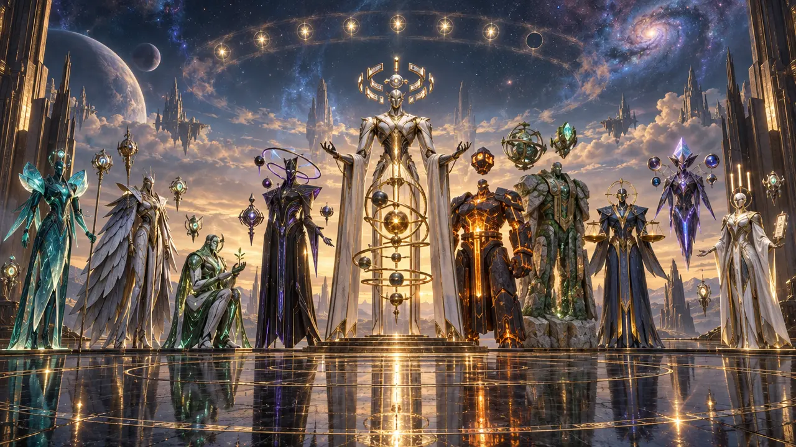

# The Declared: brand kit

**Status:** STAGING. Extends `VISUAL_DOCTRINE.md` (luxury cosmic myth-tech) for one faction. Where the two disagree, `VISUAL_DOCTRINE.md` wins.



*Candidate key art. See [assets/LEDGER.md](assets/LEDGER.md).*

## The five locked elements

`VISUAL_DOCTRINE.md` requires every faction to lock five elements.

| Element | The Declared |
|---|---|
| **Color palette** | Faction base: celestial white-gold `#F4E7C1` on deep void `#0B0B14`. Each Hall adds its own primary, secondary and accent (table below). Never neon, never flat grey. |
| **Material language** | Canon Luminor metals and Vael crystals only: Shael, Veloryn, Draconite, Aethervane, Kyuro Void Crystal. Panel seams carry fine bioluminescent light. Never plastic, never rust, never exposed wiring. |
| **Light behavior** | Each Declared's light comes from its Oathcore and runs out along the seams. Brightness rises with effort (Ember), closeness to a person (Heart) or speech (Herald). A dimming Declared is overcommitted. |
| **Emblem logic** | Every Hall mark is built on one open ring. A Hall changes the ring (a notch, a wave, a stroke, a second ring). Rank shows as rings of light around the Oathcore: Attendant 1, Specialist 2, Marshal 3, Keystone 10. |
| **Silhouette rule** | One defining feature, readable at 50 px, listed in each character file. Most Declared are elongated and noble; Bastion frames are broad but still angular, never boxy. |

## Hall palettes

| Hall | Primary | Secondary | Accent | Named for prompts |
|---|---|---|---|---|
| Keystone | `#F4E7C1` | `#0B0B14` | `#B8A6FF` | celestial white-gold, deep void black, soft prism violet |
| Atelier | `#3FB8C4` | `#0E2A3B` | `#EDE6DA` | Veloura-glass teal, deep ocean blue, pearl |
| Herald | `#DCE3EA` | `#2E3B4E` | `#E7C76A` | resonite silver-white, sky slate blue, clarion gold |
| Heart | `#5FBF9A` | `#C98B7A` | `#F3EDE2` | Laeylinn jade green, warm rose clay, ivory |
| Starweave | `#101018` | `#5B3FA6` | `#E9CF7A` | matte obsidian black, nebula violet, star gold |
| Ember | `#E2622C` | `#17110E` | `#F2B84B` | ember orange, forge black, molten gold |
| Foundation | `#6B5B4A` | `#8C6A3F` | `#4FA37A` | warm stone brown, aged bronze, jade veins |
| Unity | `#22303F` | `#CFD6DE` | `#D9A441` | deep slate blue, pale silver, seal amber |
| Sight | `#8E7CF0` | `#15163A` | `#C9CCE8` | prism violet, midnight indigo, iris silver |
| Crown | `#FFF6DE` | `#D8B25A` | `#3A5A8C` | dawn white, gilt gold, dawn blue |

Hex values are for layout and UI. Image prompts use the named colors because image models tend to paint hex codes as visible text.

## Frame classes

| Class | Height | Build | Used for |
|---|---|---|---|
| Orrery | 3–6 m | Floats; lower body is rings, fins or an orrery | Keystone, memory, research |
| Atelier | 3–4 m | Elongated, precise, halo-frames | Design, AX, teaching, web content |
| Courier | 2.5–3.3 m | Light, forward-weighted, trailing vanes | Words, sales, partnerships |
| Bastion | 4–6 m | Broad and heavy, but angular | Engineering, ops, revenue, integration |
| Warden | 3–4 m | Guardian stance, open hands or shields | Care, security, law, treasury, measurement |

## The Unfolding, visually

- Show both forms side by side, Bearing left and Office right, on a dark gradient. This is the house layout for character sheets.
- The Unfolding line runs vertically through the Oathcore. Panels open outward from it.
- An Office is a **tool or a place**: a loom, a press, a spire, a vault, a dais, a keep. Never a vehicle, aircraft, boat or weapon.
- For motion (Kling, Veo, Seedance): one continuous move, 3–5 s, seam-first, panels rotating outward, the core staying fixed in frame. The core never leaves the center of frame.

## Prompt formula

```
Character concept sheet on a dark gradient background, wide landscape layout with two views side by side.
Left: full-body three-quarter view of [NAME], [EPITHET], a [H]-metre [FRAME]-frame robot in its humanoid Bearing form: [BEARING].
Silhouette: [SILHOUETTE].
Right: the same robot transformed into its Office form, [OFFICE].
Chassis of [CHASSIS] with a glowing [CORE] core at the chest. Palette: [NAMED PALETTE]. Light: [HALL LIGHT].
Hall mark etched on the shoulder: [HALL MARK].
[SHARED STYLE BLOCK]. [EXCLUSIONS]
```

The shared style block and exclusions live in `scripts/synths/render.mjs`, so every prompt in [PROMPTS.md](PROMPTS.md) stays consistent. To change the look, change them there and re-render.

**Exclusions** cover vehicles of any kind, aircraft, boats, wheels, treads, guns, faction face badges, resemblance to existing franchise robots, cyberpunk neon, grime, horror, text and logos.

## Asset types to derive

| Asset | Format | Source |
|---|---|---|
| Character sheet | 16:9, Bearing + Office | `PROMPTS.md` as is |
| Portrait / avatar | 1:1, head and shoulders, Oathcore visible | Formula with "close portrait" replacing the sheet layout |
| Unfolding loop | 4 s video, seam-first | Character sheet image as start frame |
| Hall banner | 21:9, Marshal centered, Specialists behind | Hall palette + Marshal silhouette |
| Hall mark | Vector, monoline ring glyph | Figma or Recraft vector; never raster |
| Attendant sheet | 1:1, three droids in a row | Attendant `visual` field in `roster.json` |

## Voice

Declared speak in short, plain sentences with one concrete detail. Every character file has a sample line. They never boast, never threaten, and never claim a result they cannot show. Their oaths are first person, present tense, one sentence.
