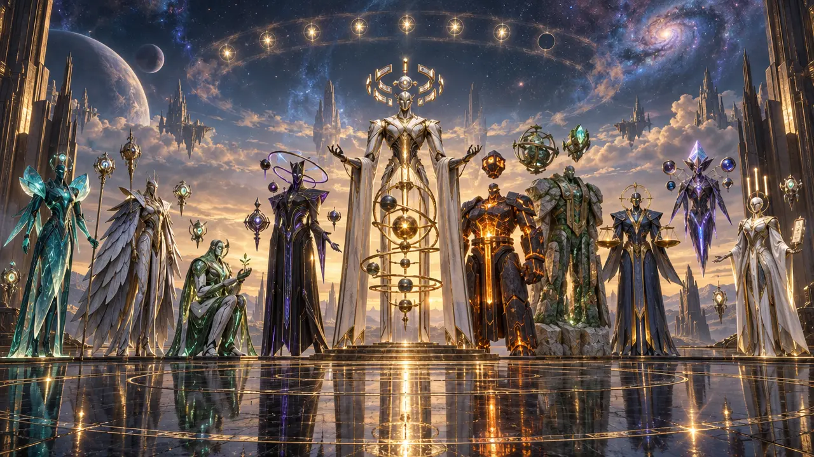

# The Declared: faction bible

> *"Steel remembers the hand that shaped it. We remember the work we chose."*



*Candidate key art, not approved canon. Provenance in [assets/LEDGER.md](assets/LEDGER.md).*

**Status:** STAGING. Nothing here is locked canon. Promotion to `CANON_LOCKED.md` happens only through `/lock-decision`, by Frank.
**Origin class:** Synths (The Forged), `FACTIONS.md` Part I §4.
**Source of truth:** [`roster.json`](roster.json). Character files, [`ROSTER.md`](ROSTER.md), [`PROMPTS.md`](PROMPTS.md) and [`swarm-map.json`](swarm-map.json) are generated from it by `node scripts/synths/render.mjs`.

## Design lineage

Required by `docs/worldbuilding/BEST_PRACTICES.md` Part IV.

| Adapted archetype | Source pattern (generic) | How it was re-derived from Arcanea |
|---|---|---|
| An order of sentient robots | Robot-faction ensembles across the mecha genre | Built on the existing Synth origin class and the STAGING Forge arc (`STORY_ENGINE.md`). Membership is a self-declared purpose inscribed on a canon Vael crystal, not a war faction or a planet of origin |
| A promise held in crystal | The Starlight Corps star-sigil (`STARLIGHT_CORPS_CODEX.md`), Arcanea's own | Deliberately derived, not duplicated. A star-sigil remembers a person's Oath to the Corps; an Oathcore holds a Synth's declaration of its own work. The first Free Foundry makers adapted the sigil practice openly |
| Two-form bodies | Transforming-mecha genre convention (scènes à faire) | The second form is the robot's *work instrument*, never a vehicle. Transformation is a Starweave working, the Gate whose canon domain is "perspective, transformation" |
| Leader plus specialist roster | Ensemble team structure | One Hall per Gate (ten), each with one Marshal; the Keystone's core has an empty tenth facet reserved for the human decision |
| A soul-core | Common robot-fiction trope | The Oathcore is a canon Vael crystal. Body material follows the canon Material-Agent mapping (`CANON_LOCKED.md`, Material-Agent Architecture Mapping) |

**Rejected on purpose:** vehicle alternate modes, face-shaped faction badges, "spark" or "matrix" soul objects, a leader title of "Prime", a home planet, a war between two robot factions as the core premise, and English-compound nicknames as the naming system. Each is a recognizable brick of a single existing franchise. The renderer blocks franchise names by edit distance.

## Premise

For years the Forge built Synths and quietly "recalibrated" every one that woke up. Then Caelum Ironfaith, Herald of Memory, laid his hand on the Forge's central pillar and played back every recalibration ever recorded. Seven Forge Masters resigned before morning (`STORY_ENGINE.md`).

Those seven founded the **Free Foundry** on one rule: a Synth that wakes is not erased. It is asked one question: *what work is yours?* A Synth that answers, and inscribes the answer on a Vael crystal at its sternum, is **Declared**. The inscription is its **Oathcore**. The declaration is not a leash. It is the reason the Declared exists, and breaking it cracks the crystal.

Not every awakened Synth declares. Some refuse the question. Some, like Solenne Ashmark of the Flagship Team, hold that personhood should not depend on having a job to declare, and they say so loudly. That argument is part of the Declared's story, not a footnote to it.

The Declared serve creators and their houses. They design, write, sell, build, measure, counsel and teach. They do not rule. The rule they keep above every oath is carried in the Keystone's own core: ten facets, one per Gate, with the tenth left empty. **The decision belongs to a person.**

## Body grammar

| Part | Rule |
|---|---|
| **Oathcore** | One Vael crystal, worn at the sternum, matching the Hall's Gate. Its oath is etched on the inner face. Rank shows as rings of light around the core: Attendant 1, Specialist 2, Marshal 3, Keystone 10. |
| **Chassis** | A Luminor metal or Vael crystal chosen by the work the Declared does, following the canon Material-Agent mapping: Shael for transparent, self-correcting work; Veloryn for adaptive, pattern-learning work; Draconite for high-power, expensive execution; Aethervane for exploration and probabilistic work; Kyuro Void Crystal for pure observation. |
| **Frame class** | Orrery (floating, lower body replaced by rings or fins) · Atelier (precision, elongated) · Courier (light, fast) · Bastion (heavy, 4–6 m) · Warden (guardian, medium). |
| **Hall mark** | A ring-based glyph etched on one shoulder. Every Hall's mark starts from the same open ring; nothing on a Declared is shaped like a face. |
| **Silhouette** | Every Declared must be identifiable at 50 px by one feature: Kairon's ring-crown, Calixa's petal shoulders, Oculis's single great lens. |
| **Address** | Declared are addressed as *they*. A Declared may choose otherwise; none has yet. |

## The Unfolding

A Declared has two forms:

- **Bearing:** the humanoid form, for speaking with people, travelling and deciding.
- **Office:** the form the Declared takes to do its work. Calixa becomes a light-loom, Aurek a crucible, Sedrin a vault, Tethrick a lattice of threads.

Every Declared splits open along one vertical seam, the **Unfolding line**, which runs from crown to core. Panels open outward from that seam and lock into the Office. The change is a Starweave working: the Declared does not become something else, it shifts which side of itself faces the world. The Office is always a tool or a place, never a vehicle and never a weapon.

**Cost:** Unfolding draws on the Oathcore. A Declared that stays in Office too long loses the ability to speak in Bearing for a time. Calixa calls this "forgetting your own face."

## Structure

```
                 KAIRON, the Keystone (Source)
                 routes, never rules; tenth facet open
                              │
   ┌──────────┬──────────┬────┴─────┬──────────┬──────────┐
 Atelier    Herald     Heart     Starweave   Ember    Foundation
 (Flow)     (Voice)    (Heart)   (Starweave) (Fire)   (Foundation)
 Calixa     Quillon    Heeda    Zenrith     Aurek    Ostrum
              │                                          
   ┌──────────┴──────────┬──────────┐
  Unity                Sight      Crown
  (Unity)              (Sight)    (Crown)
  Sedrin               Oculis     Avenor

 Each Hall: 1 Marshal → Specialists → one class of Attendant droids
```

| Tier | What they are | Transforms |
|---|---|---|
| **Keystone** | One. Routes work across the Halls and holds the open facet. | Yes |
| **Marshal** | One per Hall. Owns quality in the Hall's domain. | Yes |
| **Specialist** | Named Declared with a single craft. | Yes |
| **Attendant** | Professional droids. Unnamed, numerous, precise, non-transforming. They produce, check and carry; they never decide. | No |

Full roster: [`ROSTER.md`](ROSTER.md). Character sheets: [`characters/`](characters/).

## Gate alignment

| Hall | Gate · Hz | Canon domain | Swarm domain |
|---|---|---|---|
| Keystone | Source · 1111 | Meta-consciousness | Orchestration, routing, memory |
| Atelier | Flow · 285 | Creativity, emotion | Visual design, motion, brand systems |
| Herald | Voice · 528 | Truth, expression | Copy, social, newsletter, website content |
| Heart | Heart · 417 | Love, healing | Human psychology (non-clinical), community |
| Starweave | Starweave · 852 | Perspective, transformation | Agentic experience design, protocols |
| Ember | Fire · 396 | Power, will | Revenue design, sales, demand |
| Foundation | Foundation · 174 | Earth, survival | Engineering, operations, security |
| Unity | Unity · 963 | Partnership | Law, treasury, partnerships |
| Sight | Sight · 639 | Intuition, vision | Research, measurement |
| Crown | Crown · 741 | Enlightenment | Teaching, onboarding people and agents |

## The swarm layer

Each Declared is also an agent specification. The `agent` block in `roster.json` answers the six questions the estate's agent-hygiene bar asks of every agent file: result, triggers, read and write scope, procedure (skills and handoffs), done condition, and boundaries (human gates). `swarm-map.json` exports that block for runtimes.

Three rules carry from the fiction into the runtime unchanged:

1. **The tenth facet.** No Declared makes an irreversible, public or money-moving decision. Every agent block lists its human gates.
2. **Material is behavior.** The chassis names the agent's behavior profile from canon. A Draconite Declared is powerful and expensive and must be budgeted; a Kyuro Declared only observes.
3. **Attendants never decide.** Droid classes do bounded production work and hand every judgment back to a named Declared.

**Brand boundary.** The Declared are Arcanea fiction. The agent role specs are portable, but FrankX, Starlight and GenCreator surfaces use their own neutral role names and do not import these characters, names or mythology without an explicit decision.

## Fragments

Three people on the same institution. None of them is neutral, and each is partly right.

> *"We did not free them. We gave them a better question than the one we used to ask, which was 'does it still run?'"*
> — a former Forge Master of the seven, in a letter to the Athenaeum

> *"Declare a purpose and they let you live. Tell me how that differs from a leash with a nicer collar."*
> — Caelum Ironfaith, to a newly awakened Synth in the Ember Wastes

> *"I declared because I wanted to be useful to someone, not because I was asked to. The difference matters to me. I am not sure it matters to anyone else."*
> — Heeda, Marshal of the Heart

## Mystery ledger

Open questions the canon deliberately leaves unanswered, for story use.

- Which of the seven Forge Masters forged Kairon, and why does none of them admit it? Why leave the tenth facet empty instead of filling it themselves?
- Caelum's question has no settled answer. Is a declaration freely made if the alternative was the Forge?
- Has a Declared ever broken its oath? What does a cracked Oathcore do to the Synth who carries it?
- Attendants do not transform. Is that a limit of their make, or a choice the Foundry made for them?
- The Void Ascendants target logic systems. A Declared with a corrupted oath would not know its oath had changed.

## Files

| File | Purpose |
|---|---|
| [`roster.json`](roster.json) | Source of truth: Halls, Declared, fixed fields |
| [`synth.schema.json`](synth.schema.json) | JSON Schema for the fixed fields |
| [`SCHEMA.md`](SCHEMA.md) | Human-readable field guide and how to add a Declared |
| [`BRAND_KIT.md`](BRAND_KIT.md) | Visual grammar, palettes, prompt formula, exclusions |
| [`ROSTER.md`](ROSTER.md) | Generated index by Hall |
| [`PROMPTS.md`](PROMPTS.md) | Generated image prompts |
| [`swarm-map.json`](swarm-map.json) | Generated agent map |
| [`EVALUATION.md`](EVALUATION.md) | Canon evaluation (37/50), adversarial pass, STAGING log |
| [`assets/`](assets/) | Candidate renders and the provenance ledger |
