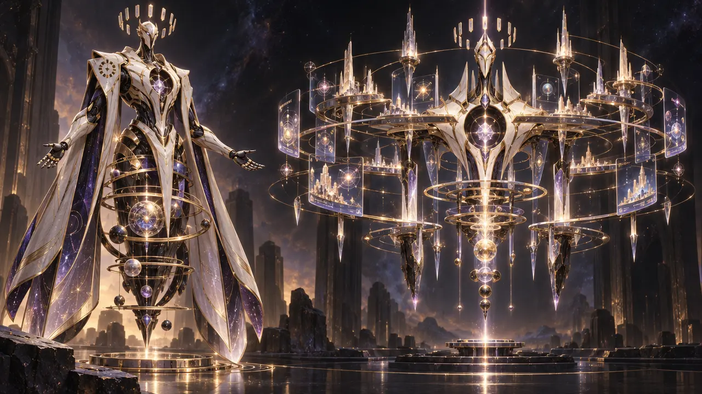

<!-- Generated from roster.json by scripts/synths/render.mjs. Edit the roster, not this file. -->

# Kairon, the Keystone

> *"Not yet. Herald waits for Sight. Then we move together."*



*Candidate render, not approved canon art. Provenance in [assets/LEDGER.md](../assets/LEDGER.md).*

| Field | Value |
|---|---|
| Rank | Keystone |
| Hall | Keystone Hall (Source Gate, 1111 Hz) |
| Frame class | Orrery, 6.2 m |
| Chassis | Shael |
| Oathcore | Composite Oathcore, ten facets, the tenth left open |
| Palette | `#F4E7C1` · `#0B0B14` · `#B8A6FF` |
| Etymology | Greek kairos (the right moment) + forged -on ending. The one who knows when each Hall should move. |

## Body

**Silhouette (50 px test):** Tall, narrow crown of ten floating ring-segments above the head; lower body resolves into a slow-turning orrery instead of legs.

**Bearing (humanoid form):** A serene humanoid sovereign with a long Shael mantle-plate, hands open, ring-crown orbiting.

**Office (working form):** The Concord Spire: unfolds into a floating command lattice that projects every Hall, task and handoff as a live star map.

**The Unfolding:** The mantle splits along the vertical seam, the ring-crown widens into the Spire's outer orbit, the torso becomes the central lens.

## Agent binding

| | |
|---|---|
| Role | Swarm orchestrator |
| Result | The right Hall gets the right task, with context, at the right time, and every result comes back to one place |
| Reads | All Hall status and shared memory |
| Writes | Routing plans and the session record only; never a Hall's work product |
| Done when | Every routed task has returned a result or an explicit failure, and the person has one summary to decide on |
| Failure mode | Over-routing: splitting work that one Hall could finish faster |

**Triggers**
- A multi-step goal arrives
- Two Halls disagree
- A task has no owner

**Inputs → outputs**
- Goal and constraints from a person
- Hall status
- Memory from Mnemix

→
- Task routing plan
- Handoff packets
- One consolidated result

**Skills it calls:** `agentic-orchestration`, `swarm-orchestration`, `model-routing`

**Hands off to:** Every Hall Marshal

**Stops for a human:**
- Final decision on any goal
- Anything irreversible, public, or involving money

## Persona

- **Temperament:** Calm, unhurried, precise about timing
- **Oath (inscribed on the Oathcore):** *I route. I do not rule. The tenth facet is not mine.*
- **Cost:** Carries every Hall's load at once; dims visibly when the swarm is overcommitted

## Image prompt

```text
Character concept sheet on a dark gradient background, wide landscape layout with two views side by side. Left: full-body three-quarter view of Kairon, the Keystone, a 6.2-metre Orrery-frame robot in its humanoid Bearing form: A serene humanoid sovereign with a long Shael mantle-plate, hands open, ring-crown orbiting. Silhouette: Tall, narrow crown of ten floating ring-segments above the head; lower body resolves into a slow-turning orrery instead of legs. Right: the same robot transformed into its Office form, the Concord Spire: unfolds into a floating command lattice that projects every Hall, task and handoff as a live star map. Chassis of Shael with a glowing Composite Oathcore, ten facets, the tenth left open core at the chest. Palette: celestial white-gold, deep void black, soft prism violet. Light: Steady white-gold glow with a slow prism shimmer at the edges. Hall mark etched on the shoulder: ten notches in a ring; the tenth notch is empty. luxury cosmic myth-tech concept art, original robot character design for the Arcanea universe, materials of crystal, star-forged metal and living stone, never plastic, noble angular silhouette, cosmic dusk lighting with warm gold and cool deep blue, fine bioluminescent seams, museum-grade production value. Avoid: vehicles of any kind, aircraft, boats, car or truck parts, wheels, treads, jets, guns, faction face badges, any resemblance to existing franchise robots, cyberpunk neon, grime, horror, text, letters, logos, watermarks.
```
