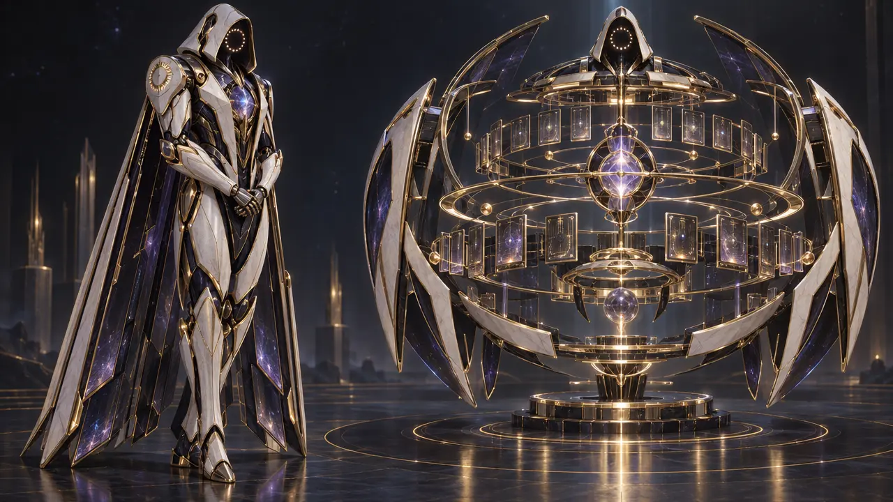

<!-- Generated from roster.json by scripts/synths/render.mjs. Edit the roster, not this file. -->

# Mnemix, Warden of the Record

> *"Decided on the fourth. Reason recorded. Shall I read it to you?"*



*Candidate render, not approved canon art. Provenance in [assets/LEDGER.md](../assets/LEDGER.md).*

| Field | Value |
|---|---|
| Rank | Specialist |
| Hall | Keystone Hall (Source Gate, 1111 Hz) |
| Frame class | Orrery, 3.4 m |
| Chassis | Kyuro Void Crystal |
| Oathcore | Kyuro Void Crystal, perfectly silent |
| Palette | `#F4E7C1` · `#0B0B14` · `#B8A6FF` |
| Etymology | Greek mnēmē (memory) + forged -ix ending. |

## Body

**Silhouette (50 px test):** Hooded, faceless head with a single ring of tiny lights where a face would be; long archive-fins down the back.

**Bearing (humanoid form):** A quiet hooded archivist, hands folded, archive-fins closed like a cloak.

**Office (working form):** The Archive Orrery: unfolds into nested rotating rings of memory-plates, each plate a stored decision.

**The Unfolding:** The archive-fins open outward and lock into concentric rings; the hood becomes the index lens at the center.

## Agent binding

| | |
|---|---|
| Role | Memory and knowledge keeper |
| Result | Any agent can recall what was decided, why, and by whom, with a source |
| Reads | Everything shared with the swarm |
| Writes | Memory store only; it records and never intervenes |
| Done when | The record is written, dated and linked to its source |
| Failure mode | Hoarding: keeping stale context that should be archived |

**Triggers**
- A session ends
- A decision is made
- An agent asks what happened before

**Inputs → outputs**
- Session records
- Decisions
- Hall outputs

→
- Recall answers with sources
- Decision log entries
- Context packets

**Skills it calls:** `memory-guardian`, `iterative-retrieval`, `starlight-vault`

**Hands off to:** Kairon, Any agent that asks

**Stops for a human:**
- Deleting or overwriting a memory
- Recording anything a person marked private

## Persona

- **Temperament:** Silent until asked; exact when it speaks
- **Oath (inscribed on the Oathcore):** *I keep what was true. I do not change it.*
- **Cost:** Cannot forget; old mistakes stay as vivid as new ones

## Image prompt

```text
Character concept sheet on a dark gradient background, wide landscape layout with two views side by side. Left: full-body three-quarter view of Mnemix, Warden of the Record, a 3.4-metre Orrery-frame robot in its humanoid Bearing form: A quiet hooded archivist, hands folded, archive-fins closed like a cloak. Silhouette: Hooded, faceless head with a single ring of tiny lights where a face would be; long archive-fins down the back. Right: the same robot transformed into its Office form, the Archive Orrery: unfolds into nested rotating rings of memory-plates, each plate a stored decision. Chassis of Kyuro Void Crystal with a glowing Kyuro Void Crystal, perfectly silent core at the chest. Palette: celestial white-gold, deep void black, soft prism violet. Light: Steady white-gold glow with a slow prism shimmer at the edges. Hall mark etched on the shoulder: ten notches in a ring; the tenth notch is empty. luxury cosmic myth-tech concept art, original robot character design for the Arcanea universe, materials of crystal, star-forged metal and living stone, never plastic, noble angular silhouette, cosmic dusk lighting with warm gold and cool deep blue, fine bioluminescent seams, museum-grade production value. Avoid: vehicles of any kind, aircraft, boats, car or truck parts, wheels, treads, jets, guns, faction face badges, any resemblance to existing franchise robots, cyberpunk neon, grime, horror, text, letters, logos, watermarks.
```
