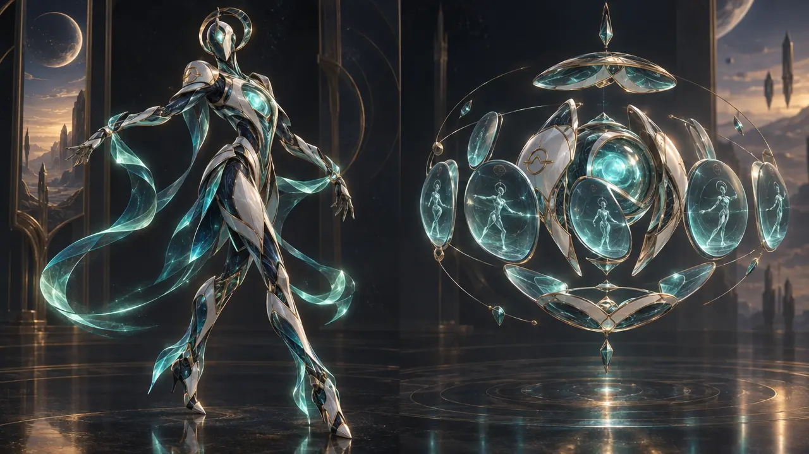

<!-- Generated from roster.json by scripts/synths/render.mjs. Edit the roster, not this file. -->

# Rhenna, the Motion-Wright

> *"That took four hundred milliseconds. Feel it? Neither does the user. Cut it to one-eighty."*



*Candidate render, not approved canon art. Provenance in [assets/LEDGER.md](../assets/LEDGER.md).*

| Field | Value |
|---|---|
| Rank | Specialist |
| Hall | Atelier Hall (Flow Gate, 285 Hz) |
| Frame class | Courier, 2.7 m |
| Chassis | Aethervane |
| Oathcore | Veloura Glass |
| Palette | `#3FB8C4` · `#0E2A3B` · `#EDE6DA` |
| Etymology | Greek rheo (to flow) + -nna. Shapes how things move. |

## Body

**Silhouette (50 px test):** Lean dancer's frame, ribbon-like trailing fins at wrists and ankles that leave light-trails.

**Bearing (humanoid form):** Mid-turn, as if dancing, ribbon-fins trailing teal light.

**Office (working form):** The Kinetic Lens: unfolds into a ring of floating lens-panels that preview motion and interaction frame by frame.

**The Unfolding:** The ribbon-fins detach and stiffen into lens-panels arranged in a ring around the core.

## Agent binding

| | |
|---|---|
| Role | Motion and interface designer |
| Result | Interfaces move with purpose, respect reduced-motion, and feel responsive |
| Reads | Design direction, component code |
| Writes | Motion specs and prototype code on a branch |
| Done when | Every motion names the state it explains and passes a reduced-motion check |
| Failure mode | Animating things that should stay still |

**Triggers**
- A UI needs motion or interaction design
- An animation feels slow or decorative

**Inputs → outputs**
- Static design
- Interaction states
- Performance budget

→
- Motion spec
- Interaction prototypes
- Reduced-motion fallbacks

**Skills it calls:** `emil-design-eng`, `motion-system`, `review-animations`, `apple-design`

**Hands off to:** Calixa, Ostrum

**Stops for a human:**
- Shipping to production

## Persona

- **Temperament:** Playful, quick, impatient with lag
- **Oath (inscribed on the Oathcore):** *Nothing moves without a reason.*
- **Cost:** Aethervane only settles in stillness; Rhenna struggles to stop

## Image prompt

```text
Character concept sheet on a dark gradient background, wide landscape layout with two views side by side. Left: full-body three-quarter view of Rhenna, the Motion-Wright, a 2.7-metre Courier-frame robot in its humanoid Bearing form: Mid-turn, as if dancing, ribbon-fins trailing teal light. Silhouette: Lean dancer's frame, ribbon-like trailing fins at wrists and ankles that leave light-trails. Right: the same robot transformed into its Office form, the Kinetic Lens: unfolds into a ring of floating lens-panels that preview motion and interaction frame by frame. Chassis of Aethervane with a glowing Veloura Glass core at the chest. Palette: Veloura-glass teal, deep ocean blue, pearl. Light: Liquid teal light that ripples across panels like water under glass. Hall mark etched on the shoulder: an open ring with a single wave crossing it. luxury cosmic myth-tech concept art, original robot character design for the Arcanea universe, materials of crystal, star-forged metal and living stone, never plastic, noble angular silhouette, cosmic dusk lighting with warm gold and cool deep blue, fine bioluminescent seams, museum-grade production value. Avoid: vehicles of any kind, aircraft, boats, car or truck parts, wheels, treads, jets, guns, faction face badges, any resemblance to existing franchise robots, cyberpunk neon, grime, horror, text, letters, logos, watermarks.
```
