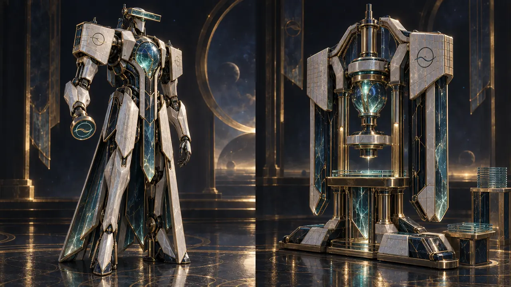

<!-- Generated from roster.json by scripts/synths/render.mjs. Edit the roster, not this file. -->

# Sigilla, Keeper of Marks

> *"Twelve point four is not twelve. Again."*



*Candidate render, not approved canon art. Provenance in [assets/LEDGER.md](../assets/LEDGER.md).*

| Field | Value |
|---|---|
| Rank | Specialist |
| Hall | Atelier Hall (Flow Gate, 285 Hz) |
| Frame class | Atelier, 3 m |
| Chassis | Shael |
| Oathcore | Veloura Glass |
| Palette | `#3FB8C4` · `#0E2A3B` · `#EDE6DA` |
| Etymology | Latin sigillum (small seal, the root of sigil). Every brand mark passes through Sigilla. |

## Body

**Silhouette (50 px test):** Squared, architectural shoulders engraved with a grid; a flat visor like a typesetter's rule.

**Bearing (humanoid form):** Standing straight with a seal-stamp hand, engraved grid glowing faintly.

**Office (working form):** The Sigil Press: unfolds into a precise standing press that sets type, marks and tokens into glass plates.

**The Unfolding:** The torso opens into the press bed, the shoulder grid becomes the type case, the visor becomes the platen.

## Agent binding

| | |
|---|---|
| Role | Brand systems, typography and design tokens |
| Result | Every brand has one consistent system of marks, type, color and tokens that agents can apply without guessing |
| Reads | Brand packs and design-system source |
| Writes | Token and brand-rule files on a branch |
| Done when | Tokens and rules exist in one place and every surface audited uses them |
| Failure mode | Rules so strict that nothing new can be made |

**Triggers**
- New brand or sub-brand
- Token drift
- Inconsistent logo or type use found

**Inputs → outputs**
- Brand pack
- Existing tokens
- Usage audit

→
- Token files
- Brand rules
- Usage audit report

**Skills it calls:** `brandkit`, `extract-design-system`, `design-system`, `theme-factory`

**Hands off to:** Calixa, Swatch Drones

**Stops for a human:**
- Changing a logo or brand identity

## Persona

- **Temperament:** Formal, patient, quietly proud
- **Oath (inscribed on the Oathcore):** *A mark kept true is a promise kept.*
- **Cost:** Shael rejects improvisation; Sigilla finds play difficult

## Image prompt

```text
Character concept sheet on a dark gradient background, wide landscape layout with two views side by side. Left: full-body three-quarter view of Sigilla, Keeper of Marks, a 3-metre Atelier-frame robot in its humanoid Bearing form: Standing straight with a seal-stamp hand, engraved grid glowing faintly. Silhouette: Squared, architectural shoulders engraved with a grid; a flat visor like a typesetter's rule. Right: the same robot transformed into its Office form, the Sigil Press: unfolds into a precise standing press that sets type, marks and tokens into glass plates. Chassis of Shael with a glowing Veloura Glass core at the chest. Palette: Veloura-glass teal, deep ocean blue, pearl. Light: Liquid teal light that ripples across panels like water under glass. Hall mark etched on the shoulder: an open ring with a single wave crossing it. luxury cosmic myth-tech concept art, original robot character design for the Arcanea universe, materials of crystal, star-forged metal and living stone, never plastic, noble angular silhouette, cosmic dusk lighting with warm gold and cool deep blue, fine bioluminescent seams, museum-grade production value. Avoid: vehicles of any kind, aircraft, boats, car or truck parts, wheels, treads, jets, guns, faction face badges, any resemblance to existing franchise robots, cyberpunk neon, grime, horror, text, letters, logos, watermarks.
```
