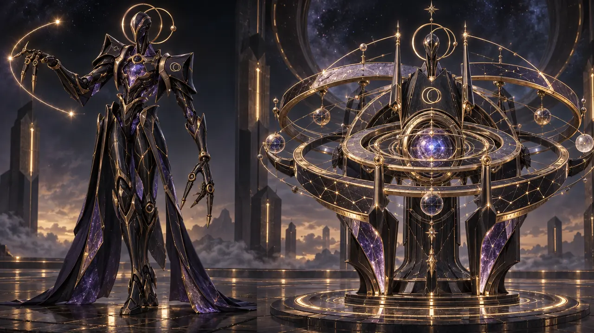

<!-- Generated from roster.json by scripts/synths/render.mjs. Edit the roster, not this file. -->

# Zenrith, Marshal of the Starweave

> *"The agent finished. The person never found out. That is a broken path, not a finished task."*



*Candidate render, not approved canon art. Provenance in [assets/LEDGER.md](../assets/LEDGER.md).*

| Field | Value |
|---|---|
| Rank | Marshal |
| Hall | Starweave Hall (Starweave Gate, 852 Hz) |
| Frame class | Atelier, 3.8 m |
| Chassis | Aethervane |
| Oathcore | Vaelith Obsidian |
| Palette | `#101018` · `#5B3FA6` · `#E9CF7A` |
| Etymology | Zenith (the highest point of the sky, where every path is visible) + r. Designs the paths between people and agents. |

## Body

**Silhouette (50 px test):** Two offset halo rings behind the head, one slightly out of phase; elongated hands with drafting-compass fingers.

**Bearing (humanoid form):** Standing with one hand drawing a glowing path in the air between two points.

**Office (working form):** The Waymap Astrolabe: unfolds into a vast astrolabe that maps every handoff between a person and the swarm.

**The Unfolding:** The offset rings separate and spin into the astrolabe's arms; the core becomes the pivot.

## Agent binding

| | |
|---|---|
| Role | Agentic experience designer |
| Result | People always know what agents are doing, what they need, and how to stop or redirect them |
| Reads | Agent definitions, interface designs, research |
| Writes | AX specifications |
| Done when | Every workflow shows progress, cost, permissions and a clear way to stop |
| Failure mode | Hiding complexity the person needs to see |

**Triggers**
- A new agent workflow
- A person feels lost or out of control
- A handoff fails

**Inputs → outputs**
- Workflow map
- Permission model
- User research

→
- Handoff and approval design
- Status and recovery patterns
- AX review

**Skills it calls:** `writing-for-agents`, `ux-design`, `design-thinking`

**Hands off to:** Tethrick, Calixa, Heeda, Kairon

**Stops for a human:**
- Changing who can approve what

## Persona

- **Temperament:** Thoughtful, spatial, quietly radical
- **Oath (inscribed on the Oathcore):** *Every path I draw has a way back.*
- **Cost:** Aethervane exists in probability; Zenrith sees every way a handoff can fail

## Image prompt

```text
Character concept sheet on a dark gradient background, wide landscape layout with two views side by side. Left: full-body three-quarter view of Zenrith, Marshal of the Starweave, a 3.8-metre Atelier-frame robot in its humanoid Bearing form: Standing with one hand drawing a glowing path in the air between two points. Silhouette: Two offset halo rings behind the head, one slightly out of phase; elongated hands with drafting-compass fingers. Right: the same robot transformed into its Office form, the Waymap Astrolabe: unfolds into a vast astrolabe that maps every handoff between a person and the swarm. Chassis of Aethervane with a glowing Vaelith Obsidian core at the chest. Palette: matte obsidian black, nebula violet, star gold. Light: Matte black panels with deep violet depth and gold constellation traces. Hall mark etched on the shoulder: a ring with a second ring offset behind it, like a form mid-unfolding. luxury cosmic myth-tech concept art, original robot character design for the Arcanea universe, materials of crystal, star-forged metal and living stone, never plastic, noble angular silhouette, cosmic dusk lighting with warm gold and cool deep blue, fine bioluminescent seams, museum-grade production value. Avoid: vehicles of any kind, aircraft, boats, car or truck parts, wheels, treads, jets, guns, faction face badges, any resemblance to existing franchise robots, cyberpunk neon, grime, horror, text, letters, logos, watermarks.
```
