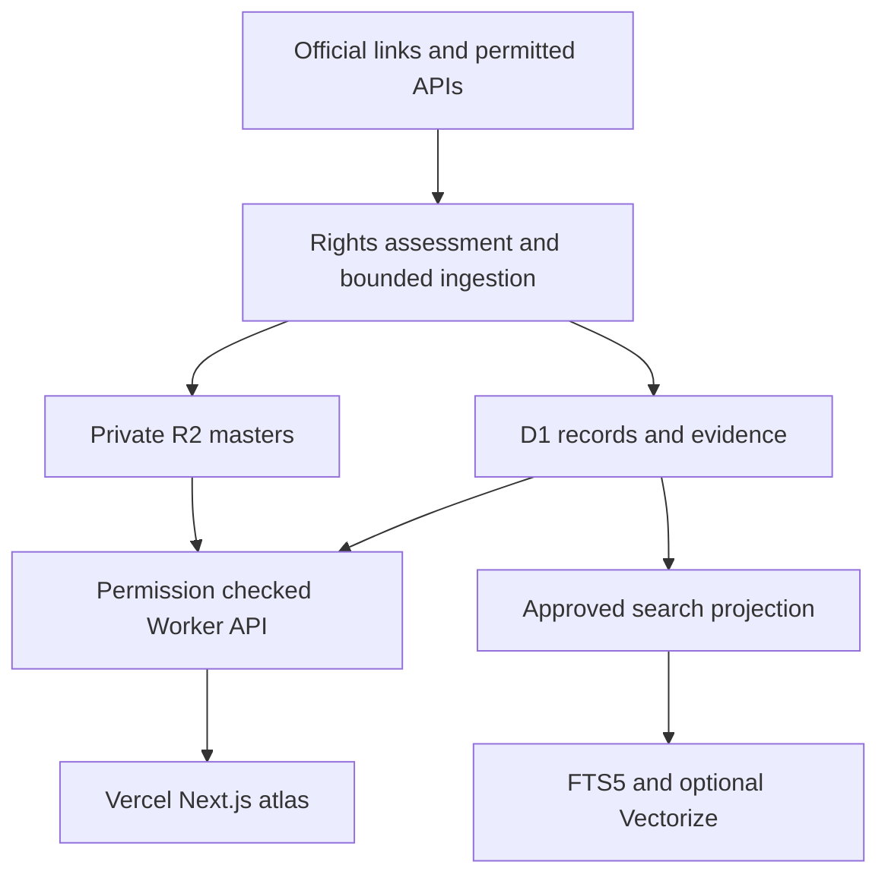

# Atlas architecture · 30 October 2026

## Decision

Use R2 for byte assets and portable JSON/NDJSON exports; D1 for the creature catalog, source evidence, relationship assertions, jobs and provenance events; FTS5 for the first search layer. Keep existing Supabase responsibility for account identity, membership and application entitlements. Next.js stays on Vercel and talks to a read-only Cloudflare Worker through a same-origin server route. No second identity system. Do not expose Cloudflare API tokens or general-purpose R2 access to the browser.

## Identity and graph

Do not merge an archetype, a traditional name, an authored species, a character and a film asset. Store distinct namespaces: `tradition:qilin`, `wizarding-world:qilin`, an individual character ID, and independently versioned visual assets. Edges include `shares_name_with`, `depicts`, `adaptation_of` (only with evidence), `inspired_by` (declared), `resembles` (inference) and `supersedes`. Similarity is not evidence of derivation. The seed includes four name-match edges only; none asserts an origin.

An **epigone** is an imitative successor, often a critical description; it is not the database category we need. Use tradition, motif, archetype, adaptation, interpretation and original proposal. A species name, its first literary attestation and its first film appearance can all have different provenance.

Keep claims separate from entities. Every claim carries evidence, asserted-by, epistemic state, observation time and, when meaningful, valid time. Unknown historical dates remain null. Record creator-claimed creation dates separately from earliest located attestations and platform receipt times. No earliest-global-creation claim follows from an upload.

## Storage

Reuse existing portfolio media buckets; isolate by tenant/brand and prefix. This release uses only private R2 and no new public bucket policy.

- Masters: `arcanea/creature-atlas/assets/sha256/ab/<digest>.<ext>`.
- Snapshots: `arcanea/creature-atlas/snapshots/<date>/<version>.json`.
- Derivatives: include original digest, variant specification digest and pipeline version in key.
- Do not put base64 images, vectors or whole HTML dumps into D1 rows.
- Deduplicate byte-identical files by SHA-256; use perceptual hashes for candidate review, never automatic ownership conclusions.
- Generate a small fixed variant set (e.g. 320, 768, 1440 WebP/AVIF) once. Avoid arbitrary per-request transformations. Originals remain private; preserve source color profile and provenance metadata in masters.
- Hot assets use Standard. Evaluate Infrequent Access only against minimum duration, retrieval and operation costs; do not move a frequently viewed gallery there by default.
- Export JSON/NDJSON plus media manifest for portable recovery. D1 and R2 are not a second independent canon authority.

## Search and vectors

FTS5 plus filters is sufficient for the seed. Add one versioned text embedding per approved entity description when semantic retrieval demonstrably improves real queries. Start with queries such as “protective coastal animal with translucent shell” and measure retrieval quality against a small judged set. Add image embeddings only to rights-cleared assets when visual similarity is a real product need.

Text and image vectors need compatible multimodal encoders for cross-modal search; an LLM text embedding and arbitrary image embedding do not share a metric space. An image caption embedding enables semantic description retrieval, not genuine visual similarity. Store model identifier, revision, dimensions, modality and digest; never mix revisions or spaces in one index. Vector results return IDs; rehydrate and re-check current permissions in D1 before any result or image is returned. Tenant isolation requires authorization before retrieval plus post-filtering; vector namespaces alone are not an authorization system.

Initial Vectorize provisioning is deferred. For 10,000 records, 768 dimensions per record means 7.68 million stored dimensions; model calls and repeated indexing can dominate storage. Verify current account-wide allowances and pricing before enabling. AI Search is an optional managed retrieval layer, not the authority; do not point auto-indexers at a mixed-rights/private bucket.

Queues and Workflows are the next ingestion implementation: durable stages, bounded retries, idempotency key, dead-letter review, per-run budget. Do not add Durable Objects, KV, Iceberg/Data Catalog or a graph database before a measured workload needs them. D1 relationship tables serve the current graph.

## Cost model

Planning assumptions: each permitted original averages 5 MB, fixed derivatives total 0.75 MB; decimal GB, Standard storage, full 10 GB free storage allowance available, no other account usage. Current documented Standard rate: $0.015/GB-month beyond free allowance. Storage only:

| Images | Stored | Estimated R2 storage/month |
|---:|---:|---:|
| 1,000 | 5.75 GB | $0.00 |
| 10,000 | 57.5 GB | $0.71 |
| 100,000 | 575 GB | $8.48 |

These exclude request operations, Workers plan/requests, D1 beyond allowances, transformations, crawling, model analysis, image generation and tax. R2 egress bandwidth is free; end-to-end service costs are not. Free allowances are account-wide. Without unused storage allowance the marginal 10,000-image storage cost is about $0.86/month. Use conditional requests/change digests and embed changed approved records once. Set hard per-job page/image/token caps; evaluate vendor budget behavior before buying bulk runs. Startup credits are not a spending target; this session did not verify the credit grant against this connected account or product coverage.

## Rollout

1. This release: bounded reference seed, D1/FTS API, private asset registry, R2 snapshot, Next.js route and review artifact.
2. Add Commons/Wikidata adapters with per-file rights extraction and reviewed test fixtures; ingest 100 rights-cleared animal/history images.
3. Add hybrid retrieval only after judged search evaluation. Add curator decisions and revocation propagation.
4. Scale to 1,000+, then consider creator submissions with abuse controls, signed uploads and authenticated review. The public read API has no write/generation authority.
